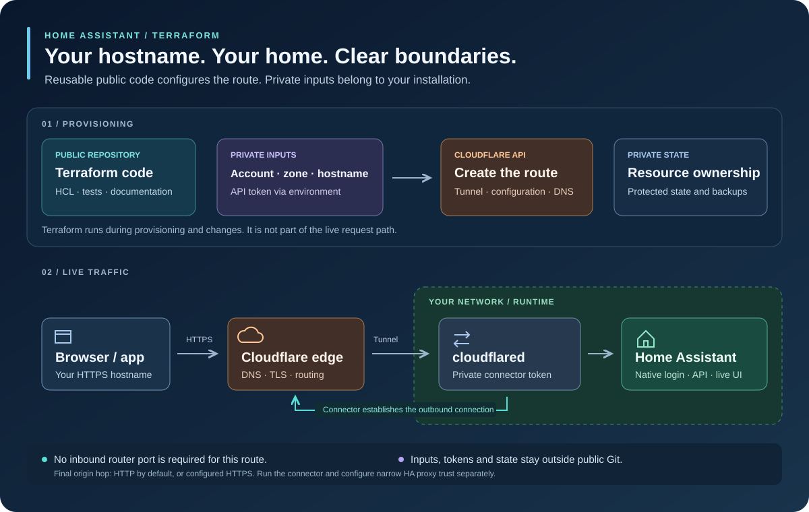
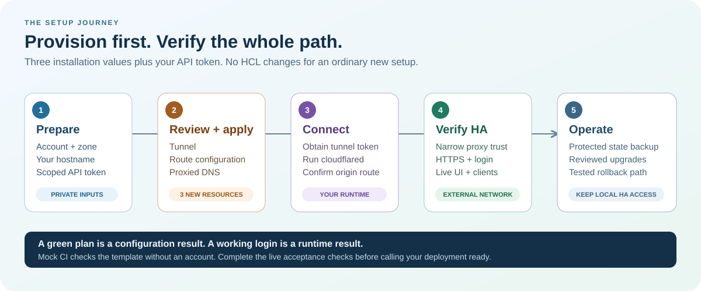

# Home Assistant · Cloudflare · Terraform

**Your Home Assistant, at your own HTTPS hostname. Reusable infrastructure, private installation values.**

Create a dedicated Cloudflare Tunnel, a proxied DNS record and the route to your
existing Home Assistant from **three values**: account ID, zone ID and hostname.
Provide the API token through your environment. Ordinary setup needs no HCL edits.



[Quick start](#quick-start) · [Configuration](docs/configuration.md) ·
[Install cloudflared](#4-connect-home-assistant) · [Runbook](docs/runbook.md) ·
[Troubleshooting](docs/troubleshooting.md) · [CI](docs/ci.md) ·
[Existing tunnels](docs/adoption.md) · [Security](SECURITY.md)

## What you get

- **A dedicated route:** HTTPS hostname → Cloudflare Tunnel → your HA origin.
- **Small, explicit infrastructure:** one tunnel, one complete tunnel configuration,
  one proxied CNAME; unmatched routes end at `http_status:404`.
- **Native HA authentication:** keep Home Assistant login, MFA and clients. No
  whole-site Cloudflare Access application is imposed by this module.
- **An existing-tunnel option:** the publication submodule manages DNS and returns
  a route for the current tunnel owner to incorporate.
- **Credential-free CI:** provider schema validation and mocked Terraform tests;
  your Cloudflare account is never needed to run them.

You bring a domain active on Cloudflare and a working Home Assistant. After
Terraform applies, run a `cloudflared` connector and configure HA proxy trust.
This project does not install HA, provision a server, run the connector or configure
your router. A successful apply creates infrastructure; the [acceptance checks](docs/runbook.md#acceptance-checks)
confirm the complete service works.

## Quick start

Use Terraform 1.7 or newer; CI tests the version pinned in
[its workflow](.github/workflows/ci.yml). The committed
[provider lock](.terraform.lock.hcl) records the checked provider version.

### 1. Keep your installation values outside Git

Clone this repository, then copy [`terraform.tfvars.example`](terraform.tfvars.example)
to a private location outside the checkout. Replace its three fictional values:

```hcl
account_id = "00000000000000000000000000000000"
zone_id    = "11111111111111111111111111111111"
hostname   = "ha.example.invalid"
```

These placeholders cannot deploy a real installation. Use the account and zone
containing your real domain, and choose a new, unused hostname in that zone.
Restrict access to the file and its backups. Existing records need the
[adoption procedure](docs/adoption.md), not a duplicate create.

### 2. Supply a scoped API token

Expose `CLOUDFLARE_API_TOKEN` to Terraform from your secret manager. It needs
**Account → Cloudflare Tunnel → Edit** for the selected account and
**Zone → DNS → Edit** for the selected zone. Only optional callback Access
management also needs **Account → Access: Apps and Policies → Edit**.
Do not place a token in the variable file, Git, shell history or CI artifacts.
These permissions follow [Cloudflare's Terraform guidance](https://developers.cloudflare.com/tunnel/guides/terraform/).

### 3. Review and apply

The following commands use a placeholder path; replace it with your private file.
Configure protected state storage before production use; see the
[state and backup runbook](docs/runbook.md#state-and-backups).

```sh
terraform init
terraform plan -var-file=/private/path/installation.tfvars
terraform apply -var-file=/private/path/installation.tfvars
```

Review the fresh plan shown by `apply` before confirming. With default inputs,
expect **3 resources to add**. No Access application is created. An existing
installation should follow the zero-change adoption workflow instead.

### 4. Connect Home Assistant

```sh
terraform output -raw tunnel_id
terraform output -raw url
```

In Cloudflare's tunnel dashboard, select this tunnel and obtain its connector
token privately. Choose the installation guide for your runtime:

- [Linux, Windows and macOS binaries](docs/cloudflared-binaries.md): verified
  downloads, token files, automatic startup and OS troubleshooting.
- [Docker and Compose](docs/cloudflared-containers.md#docker-compose): a pinned
  image, private file-backed secret and container networking.
- [k3s / Kubernetes](docs/cloudflared-containers.md#k3s--kubernetes): a Deployment,
  private Secret, probes, upgrades and cluster troubleshooting.

Start `cloudflared` where it can reach HA, set HA's external URL
to the output URL, and configure narrow reverse-proxy trust. Follow the
[connector and HA runbook](docs/runbook.md#start-the-connector), then test from
outside your network.

The default origin, `http://127.0.0.1:8123`, assumes HA listens on port 8123 in the
**connector's own network namespace**. Container loopback points at that container.
For a different host, container network or HA port, set `origin_service` in your
private variable file. See [origin examples](docs/configuration.md#origin-service).



## Choose the right module

**New dedicated tunnel:** run the repository root. Terraform owns its complete
ordered configuration; console route edits will be reconciled by the next apply.

**Existing shared tunnel:** use [`modules/publication`](modules/publication).
It creates HA DNS and, optionally, the notification callback application, then
returns an `ingress_rule`. The existing owner must add that rule to the complete
route list. Two Terraform resources must never compete to configure one tunnel.
See the [composition example](examples/shared-tunnel) and [adoption guide](docs/adoption.md).
Pin remote module sources to a reviewed full commit SHA.

`callback_access` is an advanced, disabled-by-default compatibility option. It
attaches explicitly selected existing policies at `/api/notify.html5/callback`.
It neither creates a blanket bypass nor protects the entire UI. Review its
[scope and policy behavior](docs/configuration.md#optional-notification-callback-access)
before enabling it.

## Verification and boundaries

```sh
python3 scripts/ci.py
```

The script validates disposable source copies with backends disabled and
Terraform/Cloudflare environment credentials removed. Tests use a **mock
provider**, including apply tests. Provider installation still requires registry
access or an appropriate local provider installation. The shared CI also runs
Terraform and required security checks; `CI gate` requires all validation jobs to
succeed.

The [CI guide](docs/ci.md) explains the shared workflows and validation of runtime
examples. CI does not run a live Terraform plan/apply, install services, deploy
containers or connect to your cluster. Deployment credentials stay with the
installation owner.

These checks verify configuration and contracts, not a live Cloudflare account,
DNS propagation, HA login, connector health or notifications. See the
[architecture and ownership notes](docs/architecture.md) for the trust boundaries.

All deployment values stay outside this repository. Public examples use reserved
names and synthetic IDs. See [contributing](CONTRIBUTING.md) for tests and review
expectations, and [security](SECURITY.md) before sharing diagnostics.

Licensed under [MIT](LICENSE). This is an independent community project.
