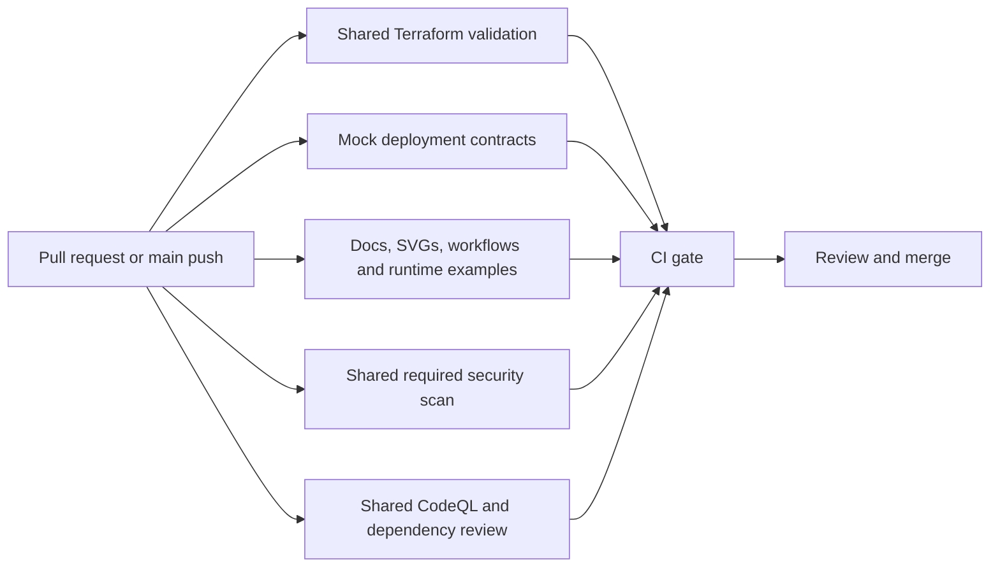

# CI: validate the template, keep deployment under operator control

The [CI workflow](../.github/workflows/ci.yml) checks every pull request, every push
to `main`, and manual validation runs. Its single required result, **CI gate**,
fails if any required job fails, is cancelled or is skipped.



## What each check proves

- **Shared Terraform validation** reuses
  [`terraform-ci.yml`](https://github.com/victron-venus/venus-os-ci-toolkit/blob/8008fd1db4c410640e7abddfc8bc75833cdcd970/.github/workflows/terraform-ci.yml)
  for formatting, backend-free initialization and validation with Terraform
  1.15.7. TFLint is not enabled: it would add no Cloudflare-specific resource
  contract coverage here.
- **Mock deployment contracts** run [`scripts/ci.py`](../scripts/ci.py) against
  the root module, publication module and shared-tunnel example. A temporary
  source copy, empty CLI credentials file and scrubbed Terraform/Cloudflare
  environment isolate the tests from local installation settings. Tests use
  `mock_provider`: even their `command = apply` evaluates a mock and does not
  call Cloudflare.
- **Documentation and runtime examples** check local Markdown links and heading
  anchors, parse every SVG and require accessible titles/descriptions, validate
  all workflows with checksum-verified actionlint 1.7.12, and validate the Docker
  Compose and Kubernetes examples against pinned, local schemas. Additional
  contracts catch mutable or mismatched image pins, embedded tokens, unsafe
  mounts, lost container hardening, broken selectors and health probes that
  would restart a healthy connector during an edge outage. Negative tests prove
  that the validators reject these mistakes. actionlint's optional shellcheck
  and pyflakes integrations are disabled to keep its result consistent across
  hosted and fallback runners.
- **Shared required security** retains
  [`security-required.yml`](https://github.com/victron-venus/venus-os-ci-toolkit/blob/8008fd1db4c410640e7abddfc8bc75833cdcd970/.github/workflows/security-required.yml):
  Trivy checks dependencies, secrets and misconfiguration, and fails on high or
  critical findings including those without a published fix.
- **Shared CodeQL and dependency review** reuses
  [`security-scan.yml`](https://github.com/victron-venus/venus-os-ci-toolkit/blob/8008fd1db4c410640e7abddfc8bc75833cdcd970/.github/workflows/security-scan.yml)
  for the Actions and Python code in this repository. Dependency Review rejects
  newly introduced high or critical dependency vulnerabilities on pull requests.
  That subcheck does not run on pushes; CodeQL still does. The shared workflow's
  result is required by CI gate. Its Trivy subcheck is disabled because the
  required security workflow already runs it.

Terraform and the running connector are different responsibilities. Passing CI
does not prove live DNS propagation, token validity, Home Assistant proxy
configuration, network reachability or NetworkPolicy enforcement. Follow the
[runbook](runbook.md) and the [runtime guide](cloudflared-containers.md) to verify
an actual installation.

## No deployment or cloud credentials in validation

CI does **not** run a real `terraform plan` or `terraform apply`, start a
container, run `kubectl`, retrieve a tunnel token or access an installation's
state. No Cloudflare or Terraform Cloud credentials are passed to these jobs.
The examples validator never interpolates local environment variables, reads
the token file referenced by Compose, or uses the active Kubernetes context.

Dependency installation, actionlint downloads, provider initialization and
GitHub security services require network access. The documentation and example
checks themselves are offline; external documentation URLs are not probed, so a
third-party outage cannot break an otherwise valid documentation change.

Approval, merge and CodeRabbit workflows remain separate metadata-only callers
of pinned shared workflows. They receive only their explicitly named bot
credentials. They do not check out or execute pull request code, and bot
automation cannot replace the required CI gate.

## Runner selection

The default is GitHub-hosted `ubuntu-latest`. The existing fallback controls are
preserved: `CI_RUNNER_MODE=self-hosted` (or `k3s`) and JSON
`CI_RUNNER_LABELS` select an operator-provisioned Linux runner for trusted
same-repository pull requests or default-branch push/manual runs. Fork pull
requests retain GitHub-hosted runners. actionlint downloads support both Linux
AMD64 and ARM64; the selected runner must also support the shared security tools.

This change does not enable the fallback or provision runners. Use the shared
[runner guide](https://github.com/victron-venus/venus-os-ci-toolkit/blob/8008fd1db4c410640e7abddfc8bc75833cdcd970/docs/RUNNERS.md)
before changing those Actions variables.

## Run the checks locally

Use Python 3.13, Terraform 1.15.7 and actionlint 1.7.12. Keep the virtual
environment outside the repository so it is not considered source by the
isolated Terraform test runner:

```sh
python3.13 -m venv "${TMPDIR:-/tmp}/ha-template-ci"
. "${TMPDIR:-/tmp}/ha-template-ci/bin/activate"
python -m pip install --require-hashes -r .github/requirements-ci.txt
python scripts/check-docs-tests.py
python scripts/check-docs.py
python scripts/validate-examples.py
actionlint -shellcheck='' -pyflakes=''
python scripts/ci.py
```

Validation-only Python dependencies are pinned with hashes in
[requirements-ci.txt](../.github/requirements-ci.txt). To update them, edit
[requirements-ci.in](../.github/requirements-ci.in), regenerate with
`uv pip compile .github/requirements-ci.in --generate-hashes --output-file .github/requirements-ci.txt --python-version 3.13`,
and rerun the checks. Schema provenance and the explicit maintenance download
command are documented in the [schema README](../.github/schemas/README.md).

## Troubleshooting

- **Missing local target or Markdown anchor:** repair the link or heading; use
  repository-relative links so the documentation works in forks too.
- **Schema rejects an unknown field:** check indentation and spelling first. An
  intentional new API field may need a reviewed schema baseline update.
- **Runtime contract fails:** compare the example with the documented security
  and token-file model. Update the contract only when the behavior is
  intentionally redesigned and reviewed.
- **actionlint checksum mismatch:** stop. Verify the upstream release and the
  downloaded asset before changing a checksum.
- **Security or dependency failure:** inspect the named finding, fix or upgrade
  the dependency, and rerun. Do not bypass CI gate or disable a scanner to merge.
- **Hosted Actions unavailable:** use the prepared runner selector only after
  verifying the fallback pool is isolated and supports these tools. A local
  validation result does not automatically satisfy the GitHub branch rule.
